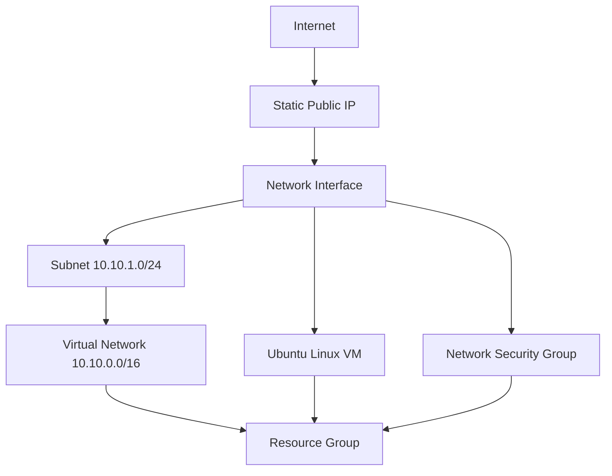

# M02 - Installing Terraform: First Azure Project

This module is a first Terraform project that provisions an Ubuntu Linux virtual machine in Microsoft Azure. It is intended for learning the Terraform workflow and the relationship between Azure networking resources and a virtual machine.

## What This Project Creates

Terraform creates these Azure resources in the `Malaysia West` region:

- One resource group: `rg-terraform-lab`
- One virtual network: `vnet-terraform-lab`
- One subnet: `snet-vm`
- One network security group: `nsg-terraform-vm`
- One public IP address: `pip-terraform-vm`
- One network interface: `nic-terraform-vm`
- One NSG-to-NIC association
- One Ubuntu 22.04 Linux virtual machine: `vm-terraform-lab`

The VM uses:

- Size: `Standard_B2ats_v2`
- Two virtual CPUs
- One GiB memory
- SSH public-key authentication
- No password authentication
- A static Standard public IP address

## Architecture



The network security group allows inbound TCP traffic on port `22` for SSH. Because the current rule uses `source_address_prefix = "*"`, SSH is open to all IPv4 addresses. For a real environment, restrict this to your own public IP or a trusted network.

## Prerequisites

Install or have access to:

1. Terraform version `1.6.0` or newer.
2. An Azure subscription with permission to create resource groups, networking resources, and virtual machines.
3. Azure CLI.
4. An SSH key pair.
5. An Azure region with capacity for the selected VM size.

Check the tools:

```bash
terraform version
az version
ssh -V
```

Sign in to Azure and select the correct subscription:

```bash
az login
az account list --output table
az account set --subscription "<subscription-name-or-id>"
az account show --output table
```

The AzureRM provider uses the Azure CLI session because this project does not explicitly configure a client ID, client secret, tenant ID, or subscription ID in `provider.tf`.

## Project Files

| File | Purpose |
| --- | --- |
| `provider.tf` | Terraform and Azure provider requirements. |
| `veriables.tf` | Input variable declarations. The filename is misspelled, but Terraform still loads it because it ends in `.tf`. `variables.tf` would be the conventional name. |
| `terraform.tfvars` | Values assigned to the input variables. This file is ignored by Git because it is environment-specific. |
| `main.tf` | Azure resource group. |
| `network.tf` | Virtual network, subnet, NSG, public IP, NIC, and NSG association. |
| `vm.tf` | Ubuntu Linux virtual machine. |
| `outputs.tf` | Values printed after apply, such as IP addresses and the SSH command. |
| `.gitignore` | Prevents local state, provider files, plans, and variable values from being committed. |
| `.terraform.lock.hcl` | Locks provider versions and provider checksums. This file should normally be committed. |

Terraform automatically loads all files ending in `.tf` in the directory. The filename order does not control resource creation order; references between resources create the dependency graph.

## `provider.tf` Explained

```hcl
terraform {
  required_version = ">= 1.6.0"

  required_providers {
    azurerm = {
      source  = "hashicorp/azurerm"
      version = "~> 4.0"
    }
  }
}

provider "azurerm" {
  features {}
}
```

Line by line:

- `terraform {` starts Terraform's configuration settings block.
- `required_version = ">= 1.6.0"` requires Terraform 1.6.0 or a newer compatible version.
- `required_providers {` begins the provider dependency declarations.
- `azurerm = {` declares the provider with the local name `azurerm`.
- `source = "hashicorp/azurerm"` identifies the provider registry source.
- `version = "~> 4.0"` allows AzureRM 4.x releases while preventing an automatic move to 5.x.
- The closing braces end the provider requirement blocks.
- `provider "azurerm" {` configures the AzureRM provider.
- `features {}` is required by the AzureRM provider, even though no optional provider features are configured.

No credentials are stored in this file. Authentication comes from the Azure CLI session established with `az login`.

## `veriables.tf` Explained

The file is named `veriables.tf`, but the correct English spelling is `variables.tf`. Terraform does not care about the spelling as long as the file ends with `.tf`.

### Location Variable

```hcl
variable "location" {
  description = "Azure region"
  type        = string
  default     = "Malaysia West"
}
```

- `variable "location"` declares an input variable named `location`.
- `description` documents what the variable means.
- `type = string` requires text input.
- `default` supplies a value when no other value overrides it.

### Resource Group Name Variable

```hcl
variable "resource_group_name" {
  description = "Resource group name"
  type        = string
  default     = "rg-terraform-lab"
}
```

- The variable stores the Azure resource group name.
- The value must be a string.
- The default name is `rg-terraform-lab`.

### VM Name Variable

```hcl
variable "vm_name" {
  description = "Virtual machine name"
  type        = string
  default     = "vm-terraform-lab"
}
```

- The variable stores the Azure VM name.
- The default value is `vm-terraform-lab`.

### Administrator Username Variable

```hcl
variable "admin_username" {
  description = "Linux VM administrator username"
  type        = string
  default     = "azureuser"
}
```

- The variable controls the Linux administrator account.
- The default account is `azureuser`.
- Password authentication is disabled, so this account uses the SSH key configured in `vm.tf`.

### SSH Public Key Path Variable

```hcl
variable "ssh_public_key_path" {
  description = "Path to SSH public key"
  type        = string
}
```

- The variable stores the path to the local public SSH key.
- There is no default, so Terraform requires a value from `terraform.tfvars`, an environment variable, or the command line.

## `terraform.tfvars` Explained

```hcl
location            = "Malaysia West"
resource_group_name = "rg-terraform-lab"
vm_name             = "vm-terraform-lab"
admin_username      = "azureuser"

ssh_public_key_path = "~/.ssh/id_ed25519.pub"
```

Each assignment supplies a value for a variable declared in `veriables.tf`:

- `location` selects the Azure region.
- `resource_group_name` selects the resource group name.
- `vm_name` selects the VM name.
- `admin_username` selects the Linux administrator name.
- The blank line is only for readability.
- `ssh_public_key_path` points to the public half of the Ed25519 key pair.

Terraform automatically loads a file named exactly `terraform.tfvars`.

Important: the old filename `terraform.tfvars.tf` was incorrect. Because it ended in `.tf`, Terraform parsed it as normal configuration and reported every variable assignment as an unsupported argument. The correct filename is `terraform.tfvars`, or a filename ending in `.auto.tfvars`.

This file is ignored by Git so local values are not committed. A team can provide a safe example file such as `terraform.tfvars.example` without real environment-specific values.

## `main.tf` Explained

```hcl
resource "azurerm_resource_group" "main" {
  name     = var.resource_group_name
  location = var.location

  tags = {
    Environment = "lab"
    ManagedBy   = "Terraform"
    Project     = "Azure-VM-Lab"
  }
}
```

Line by line:

- `resource "azurerm_resource_group" "main"` declares an Azure resource group.
- `azurerm_resource_group` is the AzureRM resource type.
- `main` is Terraform's local name for this resource.
- `name = var.resource_group_name` uses the input variable for the Azure name.
- `location = var.location` places the resource group in the selected region.
- `tags = {` starts Azure metadata tags.
- `Environment = "lab"` labels the resource as a lab environment.
- `ManagedBy = "Terraform"` records the management tool.
- `Project = "Azure-VM-Lab"` associates the resource with this project.

Other resources reference this resource with expressions such as `azurerm_resource_group.main.name` and `azurerm_resource_group.main.location`. Those references cause Terraform to create the resource group first.

## `network.tf` Explained

### Virtual Network

```hcl
resource "azurerm_virtual_network" "main" {
  name                = "vnet-terraform-lab"
  location            = azurerm_resource_group.main.location
  resource_group_name = azurerm_resource_group.main.name

  address_space = ["10.10.0.0/16"]

  tags = {
    Environment = "lab"
    ManagedBy   = "Terraform"
  }
}
```

- The resource type is `azurerm_virtual_network`.
- The local Terraform name is `main`.
- `name` is the Azure virtual network name.
- `location` reuses the resource group's location.
- `resource_group_name` places the network in the resource group.
- `address_space` defines the virtual network CIDR range.
- `10.10.0.0/16` provides private addresses from `10.10.0.0` through `10.10.255.255`.
- The tags identify the environment and management tool.

### Subnet

```hcl
resource "azurerm_subnet" "main" {
  name                 = "snet-vm"
  resource_group_name  = azurerm_resource_group.main.name
  virtual_network_name = azurerm_virtual_network.main.name

  address_prefixes = ["10.10.1.0/24"]
}
```

- The subnet is named `snet-vm`.
- It belongs to the resource group and virtual network created above.
- `address_prefixes` gives the subnet the `10.10.1.0/24` range.
- The `/24` range provides 256 addresses before Azure reserves some addresses for platform use.

### Network Security Group

```hcl
resource "azurerm_network_security_group" "vm" {
  name                = "nsg-terraform-vm"
  location            = azurerm_resource_group.main.location
  resource_group_name = azurerm_resource_group.main.name

  security_rule {
    name                       = "allow-ssh"
    priority                   = 100
    direction                  = "Inbound"
    access                     = "Allow"
    protocol                   = "Tcp"
    source_port_range          = "*"
    destination_port_range     = "22"
    source_address_prefix      = "*"
    destination_address_prefix = "*"
  }

  tags = {
    Environment = "lab"
    ManagedBy   = "Terraform"
  }
}
```

- The NSG is named `nsg-terraform-vm`.
- `security_rule` defines one traffic rule.
- `name = "allow-ssh"` identifies the rule.
- `priority = 100` determines its evaluation order; lower numbers have higher priority.
- `direction = "Inbound"` applies to traffic entering the resource.
- `access = "Allow"` permits matching traffic.
- `protocol = "Tcp"` limits the rule to TCP traffic.
- `source_port_range = "*"` accepts any source port.
- `destination_port_range = "22"` allows SSH traffic to port 22.
- `source_address_prefix = "*"` allows traffic from every source address.
- `destination_address_prefix = "*"` allows traffic to every destination address on the attached interface.

For production, replace the source `*` with a trusted CIDR, such as your office or home public IP range.

### Public IP Address

```hcl
resource "azurerm_public_ip" "vm" {
  name                = "pip-terraform-vm"
  location            = azurerm_resource_group.main.location
  resource_group_name = azurerm_resource_group.main.name

  allocation_method = "Static"
  sku               = "Standard"

  tags = {
    Environment = "lab"
    ManagedBy   = "Terraform"
  }
}
```

- The public IP is named `pip-terraform-vm`.
- It uses the resource group's location and resource group.
- `allocation_method = "Static"` keeps the address stable while the resource exists.
- `sku = "Standard"` selects Azure's Standard public IP SKU.
- The tags identify the resource.

### Network Interface

```hcl
resource "azurerm_network_interface" "vm" {
  name                = "nic-terraform-vm"
  location            = azurerm_resource_group.main.location
  resource_group_name = azurerm_resource_group.main.name

  ip_configuration {
    name                          = "internal"
    subnet_id                     = azurerm_subnet.main.id
    private_ip_address_allocation = "Dynamic"
    public_ip_address_id          = azurerm_public_ip.vm.id
  }

  tags = {
    Environment = "lab"
    ManagedBy   = "Terraform"
  }
}
```

- The NIC is named `nic-terraform-vm`.
- `ip_configuration` defines how the interface connects to Azure networking.
- `name = "internal"` names the NIC IP configuration.
- `subnet_id` attaches the NIC to `snet-vm`.
- `private_ip_address_allocation = "Dynamic"` lets Azure assign a private address from the subnet.
- `public_ip_address_id` attaches the static public IP.
- The VM later receives this NIC through `network_interface_ids`.

### NSG-to-NIC Association

```hcl
resource "azurerm_network_interface_security_group_association" "vm" {
  network_interface_id      = azurerm_network_interface.vm.id
  network_security_group_id = azurerm_network_security_group.vm.id
}
```

- This is an association resource rather than a separate network object.
- `network_interface_id` selects the VM's NIC.
- `network_security_group_id` attaches the SSH security rules to that NIC.
- The references ensure the NIC and NSG exist before Terraform creates the association.

## `vm.tf` Explained

```hcl
resource "azurerm_linux_virtual_machine" "main" {
  name                = var.vm_name
  resource_group_name = azurerm_resource_group.main.name
  location            = azurerm_resource_group.main.location

  size = "Standard_B2ats_v2"

  admin_username = var.admin_username

  network_interface_ids = [
    azurerm_network_interface.vm.id
  ]

  disable_password_authentication = true
```

- `resource "azurerm_linux_virtual_machine" "main"` declares the Azure Linux VM.
- `name` uses the configured VM name.
- `resource_group_name` places the VM in the existing resource group.
- `location` places it in the same region as the resource group.
- `size = "Standard_B2ats_v2"` selects the VM hardware size.
- `admin_username` sets the Linux administrator account.
- `network_interface_ids` attaches the previously created NIC.
- `disable_password_authentication = true` requires SSH key authentication and disables password login.

The original size was `Standard_B2s`, but Azure returned `SkuNotAvailable` because that SKU had no capacity in `MalaysiaWest`. The configuration was changed to `Standard_B2ats_v2`, which matches the available Azure size selected during the lab.

### SSH Key Configuration

```hcl
  admin_ssh_key {
    username   = var.admin_username
    public_key = file(pathexpand(var.ssh_public_key_path))
  }
```

- `admin_ssh_key` configures public-key authentication.
- `username` applies the key to the Linux administrator account.
- `pathexpand` expands `~` to the user's home directory.
- `file` reads the public key file contents.
- Azure stores the public key on the VM. The private key remains on the local computer.

### OS Disk

```hcl
  os_disk {
    name                 = "${var.vm_name}-osdisk"
    caching              = "ReadWrite"
    storage_account_type = "Standard_LRS"
  }
```

- `os_disk` configures the operating system disk.
- The name uses Terraform interpolation to create a name such as `vm-terraform-lab-osdisk`.
- `caching = "ReadWrite"` enables read and write host caching.
- `storage_account_type = "Standard_LRS"` uses locally redundant standard storage.

### Ubuntu Image

```hcl
  source_image_reference {
    publisher = "Canonical"
    offer     = "0001-com-ubuntu-server-jammy"
    sku       = "22_04-lts-gen2"
    version   = "latest"
  }
```

- `publisher = "Canonical"` selects the Ubuntu publisher.
- `offer` selects the Ubuntu Server Jammy offer.
- `sku` selects Ubuntu 22.04 LTS Gen2.
- `version = "latest"` selects the newest image version available at apply time.

Using `latest` is convenient for a lab. Production environments often pin a tested image version for repeatability.

### VM Tags

```hcl
  tags = {
    Environment = "lab"
    ManagedBy   = "Terraform"
    Project     = "Azure-VM-Lab"
  }
}
```

The tags make the VM easier to identify, filter, and manage in Azure. The final brace closes the VM resource block.

## `outputs.tf` Explained

```hcl
output "resource_group_name" {
  value = azurerm_resource_group.main.name
}
```

Prints the created resource group name after `terraform apply`.

```hcl
output "vm_name" {
  value = azurerm_linux_virtual_machine.main.name
}
```

Prints the VM name.

```hcl
output "public_ip_address" {
  value = azurerm_public_ip.vm.ip_address
}
```

Prints the public IP address assigned by Azure.

```hcl
output "private_ip_address" {
  value = azurerm_network_interface.vm.private_ip_address
}
```

Prints the VM's private address inside the subnet.

```hcl
output "ssh_command" {
  value = "ssh ${var.admin_username}@${azurerm_public_ip.vm.ip_address}"
}
```

Builds an SSH command using the configured Linux username and the Azure public IP. If the private key is not the default SSH key, use the explicit form instead:

```bash
ssh -i ~/.ssh/id_ed25519 azureuser@<public-ip-address>
```

## `.gitignore` Explained

```gitignore
.terraform/
*.tfstate
*.tfstate.*
*.tfplan
crash.log
crash.*.log

terraform.tfvars
*.pem
*.key
```

- `.terraform/` ignores downloaded providers and local Terraform working files.
- `*.tfstate` ignores Terraform state files.
- `*.tfstate.*` ignores state backups and related state files.
- `*.tfplan` ignores saved binary plans.
- `crash.log` and `crash.*.log` ignore Terraform crash logs.
- `terraform.tfvars` ignores local variable values.
- `*.pem` and `*.key` ignore common private-key file formats.

Terraform state can contain resource IDs, IP addresses, and sensitive values. Do not commit it to a public repository. For team usage, use a remote backend with access control and state locking.

## Standard Terraform Workflow

Run these commands from the project directory.

### 1. Format the code

```bash
terraform fmt
```

Formats all Terraform files using Terraform's canonical style.

### 2. Initialize Terraform

```bash
terraform init
```

Initialization:

- Downloads the AzureRM provider.
- Creates the `.terraform/` directory.
- Reads provider requirements.
- Creates or updates `.terraform.lock.hcl`.

If Terraform reports unsupported arguments on `terraform.tfvars`, check that the file is named `terraform.tfvars`, not `terraform.tfvars.tf`.

### 3. Validate the configuration

```bash
terraform validate
```

Checks Terraform syntax, types, references, and provider resource structure. Validation does not prove that Azure has capacity or that the deployment will succeed.

### 4. Review a plan

```bash
terraform plan
```

Reads the current state and compares it with the desired configuration. It shows resources Terraform would create, update, or destroy.

For a reproducible apply:

```bash
terraform plan -out=tfplan
```

The saved plan is ignored by Git and should be applied soon after it is created.

### 5. Apply the plan

```bash
terraform apply tfplan
```

Creates or changes the Azure resources exactly as recorded in the saved plan.

If no saved plan exists, Terraform can create an interactive plan:

```bash
terraform apply
```

### 6. Read outputs

```bash
terraform output
terraform output public_ip_address
terraform output -raw ssh_command
```

The `-raw` option prints a string without Terraform's quotation marks.

### 7. Connect with SSH

```bash
ssh -i ~/.ssh/id_ed25519 azureuser@<public-ip-address>
```

The private key must match the public key configured in `terraform.tfvars`. Protect the private key with appropriate file permissions:

```bash
chmod 600 ~/.ssh/id_ed25519
```

### 8. Destroy the lab

```bash
terraform destroy
```

Review the destruction plan and confirm only when you are ready. This deletes the resources managed by this Terraform state.

## Problems Encountered During This Module

### `terraform.tfvars.tf` reported unsupported arguments

Cause: Terraform treats every `.tf` file as configuration. Assignments such as `location = "Malaysia West"` are valid in a variable-values file but not as top-level configuration arguments.

Fix:

```bash
mv terraform.tfvars.tf terraform.tfvars
terraform init
```

### State lock could not be acquired

Cause: Terraform had a local state lock in `.terraform.tfstate.lock.info`. A previous `terraform plan` process was suspended with `Ctrl+Z`, so it continued to hold the lock.

The process was identified with:

```bash
pgrep -alf terraform
ps -p <pid> -o pid=,stat=,etime=,command=
```

A `T` process status means stopped or suspended. Resume and cancel it from its original terminal:

```bash
fg
# Press Ctrl+C
```

If the process is definitely stale, terminate it, then verify no Terraform process remains:

```bash
kill <pid>
pgrep -alf terraform
```

For a stopped process that does not respond to a normal termination signal:

```bash
kill -9 <pid>
```

Only after confirming that no Terraform process is running should a stale local lock file be removed:

```bash
rm .terraform.tfstate.lock.info
```

Do not routinely use `-lock=false`. Locking protects state from concurrent Terraform operations.

### `SkuNotAvailable` for `Standard_B2s`

Cause: Azure returned HTTP `409 Conflict` because `Standard_B2s` had no available capacity in `MalaysiaWest`.

Fix: select another size with capacity, such as:

```hcl
size = "Standard_B2ats_v2"
```

The replacement must still be available in the selected region and compatible with the desired operating system image.

## Useful Inspection Commands

```bash
terraform show
terraform state list
terraform state show azurerm_linux_virtual_machine.main
terraform output
az vm list --resource-group rg-terraform-lab --output table
az network public-ip show \
  --resource-group rg-terraform-lab \
  --name pip-terraform-vm \
  --output table
```

- `terraform show` displays the current state or a plan.
- `terraform state list` lists resources tracked in state.
- `terraform state show` displays one tracked resource.
- `terraform output` displays declared outputs.
- The Azure CLI commands inspect the actual Azure resources.

## Learning Outcomes

After completing this module, you should understand:

- How Terraform discovers `.tf` configuration files.
- The difference between Terraform configuration and `.tfvars` variable values.
- How providers connect Terraform to an external platform.
- How input variables make configuration reusable.
- How resource references create dependencies.
- How a VM depends on a resource group, network, subnet, NIC, public IP, and NSG.
- How Terraform state tracks infrastructure.
- Why state locking prevents concurrent operations.
- How `plan` previews changes and `apply` performs them.
- How Azure region capacity can require changing a VM SKU.
- Why state, variable files, private keys, and generated plans should not be committed.

## Current Module Result

The successful saved plan contains:

```text
Plan: 1 to add, 0 to change, 0 to destroy.
```

The resource group and network resources already exist in Azure. The remaining planned resource is the Linux VM using `Standard_B2ats_v2`.
